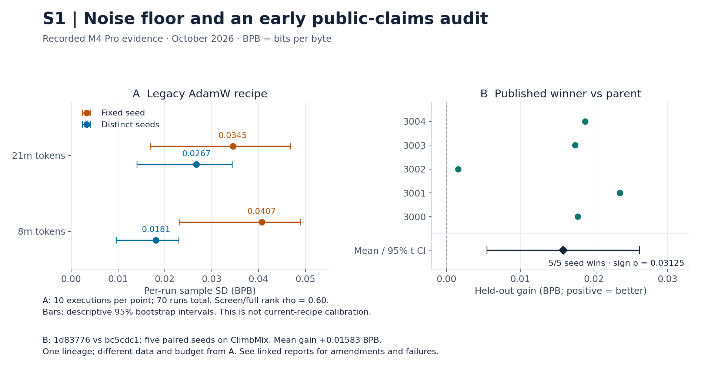

# openloop

Openloop is an experiment workbench for automated research. It records what ran,
checks whether a gain survives fresh seeds and held-out evaluation, and gives
agents and researchers the same tools to inspect the evidence.

The core has four parts: a content-addressed ledger, an `Env`-shaped loop
interface, executors, and a decider. Allocation, proposal and implementation,
research memory, agent tools, and the UI are plugins. See [DESIGN.md](DESIGN.md).
The current loops are planted truth (T0), MLX pretraining (T1), and recorded
NAS-Bench-201/HPO-B outcomes (T4). T2 post-training, T3 data mixtures, and cloud
execution remain planned. See the [loop guide](docs/LOOPS.md).

## Needs and evidence

These are proposed needs.
[NEEDS.md](NEEDS.md#n1n10) preserves the evidence, confidence, design inferences,
and acceptance checks for each row. A working component does not establish that
its research goal has been achieved.

| ID | Need | Current evidence or implementation |
| --- | --- | --- |
| N1 | Make every experiment traceable and reproducible. | [Immutable ledger, provenance, cache and drift probe](docs/LEDGER.md). |
| N2 | Check whether an improvement is real before using it. | [Noise-aware decisions](docs/DECIDER.md); measured S1 evidence below. |
| N3 | Direct parallel compute toward useful experiments. | [Five allocator policies](docs/ALLOCATORS.md) and [mock replay](docs/MOCK_EXECUTOR.md). Policy performance and native scale remain unmeasured. |
| N4 | Connect architecture, data, evaluation, and training loops. | [Shared loop contract](docs/LOOPS.md) and [T4 adapters](docs/T4.md). T3 composition remains planned. |
| N5 | Reduce time from hypothesis to verified decision. | [Stage timestamps](docs/LEDGER.md) and [researcher UI](docs/UI.md). Researcher time savings remain unmeasured. |
| N6 | Let agents operate while people set direction. | [Agent toolbelt](docs/TOOLBELT.md) and [proposer/implementer operators](docs/OPERATORS.md). |
| N7 | Use verified history to select the next experiment. | [Research memory](docs/MEMORY.md). Its effect on research progress remains unmeasured. |
| N8 | Contain autonomous experiment code. | [Docker execution with network denied by default](docs/EXECUTORS.md). A Git worktree alone is not a security boundary. |
| N9 | Keep the core small and stable. | [Core and plugin boundaries](DESIGN.md#core-and-plugins). |
| N10 | Support Google Cloud execution. | [Proposed executor design](DESIGN.md#executors). No production GCP backend is implemented. |

## S1: measured noise and an early audit



The [70-run calibration report](research/s1/run-2026-10-11/report.json) records
20 baseline runs per fidelity and 30 candidate-ranking runs. Screen/full
Spearman correlation was **0.60**, with a descriptive matched-seed bootstrap
95% interval of **[0.2571, 0.8857]**. These measurements apply to the legacy AdamW
recipe, not the [current shared recipe](src/openloop/loops/recipes/m4_pro_v1/README.md).

The separate [public-claims audit](research/s1-part2/README.md) compares published
winner `1d83776` with parent `bc5cdc1` on ClimbMix. The
[final five-pair report](research/s1-part2/run-heldout-2026-10-13d/heldout-report.json)
records **+0.01583 BPB mean held-out gain**, a **95% t interval of
[+0.00547, +0.02619]**, and **5/5 seed wins** (one-sided exact sign p = 0.03125).
It met the audit's amended replication rule. This is one lineage on one machine;
it is not an estimate of the fraction of all public claims that replicate.
The four reconstructed discards were indistinguishable from the winner under
the audit comparisons. The reports retain failures, exclusions, and amendments.
The figure uses the final five pairs, not the superseded four-pair estimate.

Rebuild this one figure from the recorded JSON inputs (no training or API calls):

```sh
uv run --script research/render_s1_figure.py
```

The script pins its plotting dependency and embeds input SHA-256 hashes in the
PNG and [SVG](docs/figures/s1-summary.svg). The two panels use different recipes,
datasets, budgets, and analyses; their scores must not be pooled.

## Planned studies

[PROTOCOL.md](PROTOCOL.md) fixes S2 allocation, S3 memory ablation, S4 evaluation
overfit detection, S5 loop composition, and S6 scale transfer. Commit the protocol
and each study's complete run manifest before collecting its study evidence.
Study execution and spending need separate approval. The protocol records the
missing T3, T2, CUDA, and held-out isolation prerequisites.

## Development

Install [uv](https://docs.astral.sh/uv/getting-started/installation/), then run:

```sh
uv sync --locked
uv run pre-commit install
```

Python 3.12 is selected by `.python-version`. uv installs it if needed.

Run the checks:

```sh
uv run pre-commit run --all-files
uv run pyright
uv run pytest
```

Source code lives in `src/openloop/`; tests live in `tests/`.
Commit `uv.lock` when changing dependencies so development and CI use the same versions.
Read [CONTRIBUTING.md](CONTRIBUTING.md) before changing code; agents also follow [AGENTS.md](AGENTS.md).

## Environment ledger

On native Apple silicon macOS, `uv sync --locked` also installs MLX and mlx-lm.
Capture this machine's environment as the first ledger field:

```sh
uv run python -m openloop.env_probe --output ledger.json
```

The probe prints JSON with two fields. `environment` holds only stable facts that
can affect results: the chip, physical RAM in bytes, macOS, architecture, and the
Python and MLX versions. Hash this field for `ExperimentInputs.environment_hash`.
`calibration` holds the capture time and a GPU matmul benchmark; it is a
measurement, so it is excluded from identity. The saved `ledger.json` is local and
ignored by Git; existing files are never overwritten. Omit `--output` to print a
fresh record without saving it.

The default benchmark multiplies two seeded 2048×2048 float32 matrices on Metal,
warms up three times, then measures ten runs. Inputs are evaluated before timing;
each matmul is evaluated and synchronized before the timer stops. Raw samples,
median latency, and GFLOP/s (`2*N³ / seconds / 1e9`) are recorded. This measures
warm matmul latency including dispatch and synchronization, not LLM throughput.
Use `--size`, `--warmup`, and `--repeats` to change the calibration workload.

Linux CI checks the portable logic and skips the Metal integration test.

## Experiment ledger

[`openloop.ledger`](docs/LEDGER.md) records immutable experiment inputs and
append-only execution evidence in SQLite. It provides `submit`, `get`, `lineage`,
and `query`, with per-stage UTC timestamps, cache reuse, retries, and a
`candidate_hash` that groups one candidate's samples across seeds. Reused
submissions preserve provenance without adding samples.

[`openloop.probe`](src/openloop/probe.py) runs an explicit replication and records
the comparison. Inputs declare `reproducibility`: drift on `deterministic` inputs
disables result-cache reuse, while drift on `noisy` inputs is recorded as measured
variation.

See the [ledger guide](docs/LEDGER.md) for the schema, API, and a synthetic example.
The new SQLite ledger is separate from the setup record in `ledger.json`.

## Loop interface

[`openloop.loops`](docs/LOOPS.md) provides an `Env`-shaped contract through the
ledger API. T0 supplies a planted objective with seeded noise. T1 adapts the pinned
MLX training script to exact token budgets at two fidelities (8m and 21m tokens).
Candidate settings, frozen evaluators, and work limits are checked before publication.
The [loop guide](docs/LOOPS.md) includes an offline example and native-worker requirements.
The [T4 adapters](docs/T4.md) expose NAS-Bench-201 architecture lookups and HPO-B configuration lookups through the same interface.

The [public M4 Pro reproduction](research/reproductions/m4-pro-2026-10-10/README.md)
reached 1.410165 val_bpb with the unmodified published winner, against its 1.429396
reference. This uses the original ClimbMix evaluator; the frozen FineWeb-Edu T1
baseline remains separate.

## Executors

[`openloop.executors`](docs/EXECUTORS.md) provides local processes and committed Git
source inside Docker. Both expose `submit`, `poll`, `cancel`, and `collect`, with
idempotent keys, lifecycle timestamps, resource limits, and hashed logs.
The sandbox denies network access by default. T1 uses the local executor and one
shared GPU lane. See the [executor guide](docs/EXECUTORS.md) for trust boundaries.
The [mock backend](docs/MOCK_EXECUTOR.md) replays recorded outcomes and durations at simulated worker capacity, without executing commands or waiting in real time.

## Decider

[`openloop.decider`](docs/DECIDER.md) freezes the comparison family, noise
calibration, and seed schedules. It offers noise-aware and AutoScientists screen
policies. Both use fresh-seed confirmation with a family error bound, followed by
one trusted held-out batch after selection closes. The coordinator is in memory
unless it opts in to a ledger-backed campaign journal that a new process can restore;
held-out file isolation remains a host responsibility.
The [CPU-only T0 study](docs/decider-t0.json) measures detection rate across effect sizes
and false-confirmation rate under nulls for each decision rule on simulated truth.

```sh
uv run python -m openloop.studies.t0_decider --trials 384 --output docs/decider-t0.json
```

## Allocation

[`openloop.allocators`](docs/ALLOCATORS.md) selects screen jobs through one pure interface.
It provides greedy, random, UCB1 bandit, successive halving, and a declared-grid Hyperband variant.
Each batch respects the supplied work budget and free worker slots.
The [guide](docs/ALLOCATORS.md) defines the policy choices and includes a CPU-only example.
S2 policy comparisons and scale projections remain planned.

## Research operators

The [research operators](docs/OPERATORS.md) provide draft, improve, debug, and combine hypothesis cards.
The implementer applies permitted file edits in a network-disabled container worktree and requires a smoke pass.
The ledger limits each card to one attempt and two repairs. It records implementation and measured idea failures separately.
Providers are injected; the default package starts no model API calls.

## Research memory

The [research memory plugin](docs/MEMORY.md) stores verified positive findings.
It reloads ledger scores and replays the complete selection and held-out test
before publication. Reports include effect statistics, evidence counts, scope,
and simulation markers. Python queries and a read-only JSON CLI expose the reports.
Memory is not added to proposer context automatically.

## Agent toolbelt

The [agent toolbelt](docs/TOOLBELT.md) exposes `run_diff`, `metric_query`, and
`repository_map` through Python and an MCP stdio server. It opens the configured
ledger read-only, excludes held-out measurements, and maps committed Python
definitions without executing source. The guide includes setup and tool contracts.

## Researcher UI

The [local UI](docs/UI.md) shows experiment lineage, endpoint curves with observed
seed variation bands, and run diffs. It reads the ledger without changing it.
Start it with `uv run python -m openloop.ui --ledger /absolute/path/ledger.sqlite3`.
Held-out measurements remain excluded.

## Frozen training data

The [FineWeb-Edu corpus](data/fineweb-edu/README.md) uses three pinned shards,
with exact-content duplicates removed and stable 90/5/5 train, validation, and
held-out memberships. Prepare or verify it from the repository root:

```sh
uv run python -m openloop.fineweb
uv run python -m openloop.fineweb --verify
```

The frozen manifest records source checksums, membership checksums, and a snapshot
hash. Raw data and membership Parquet files remain local.

NAS-Bench-201 and HPO-B are also downloaded and verified through their official
loaders. See the [tabular benchmark setup and load reports](data/tabular/README.md).
Their dependencies are isolated in the optional `benchmarks` group.

## License

Licensed under [Apache-2.0](LICENSE).
